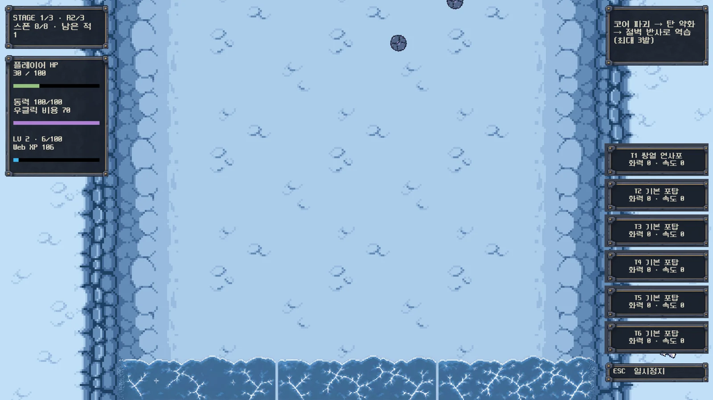
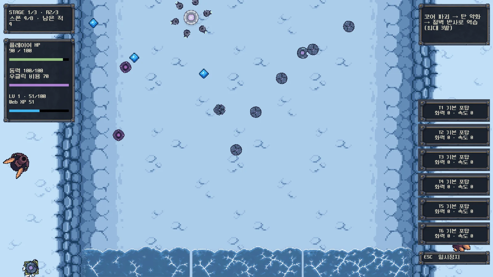
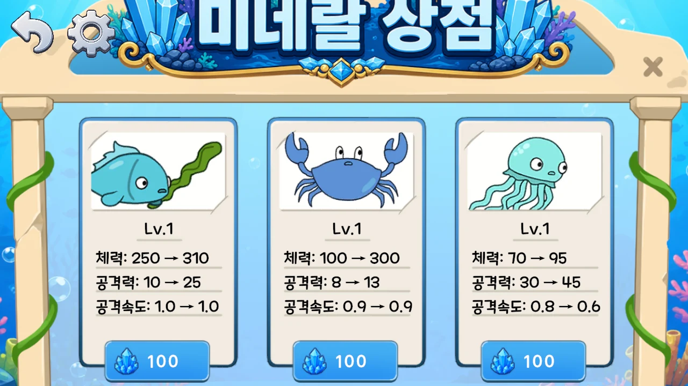
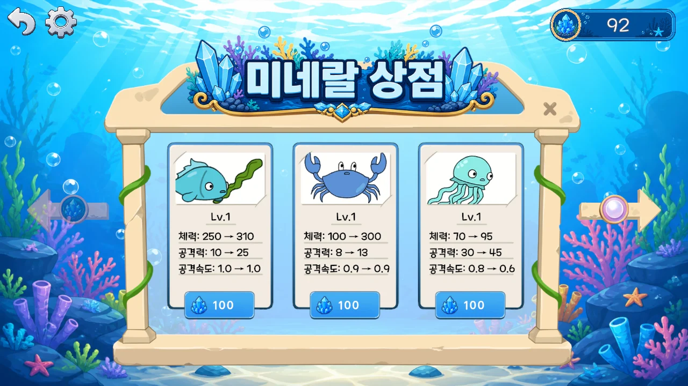
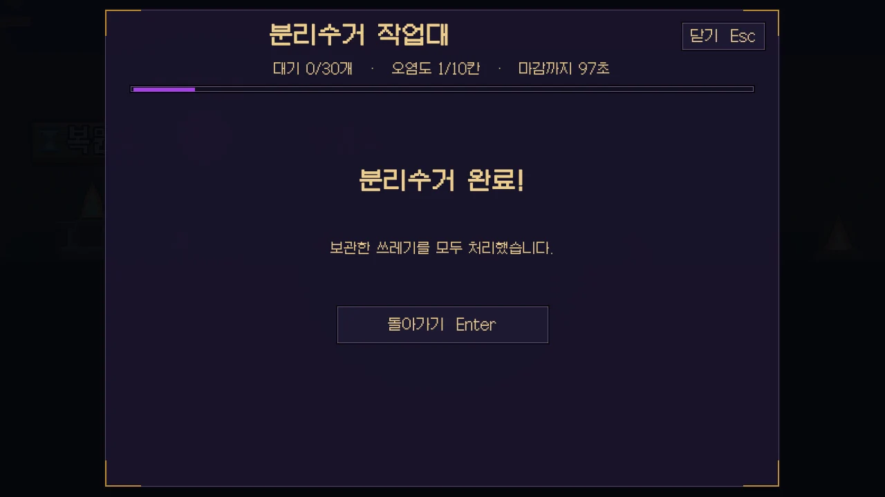

# 게임 QA 검증 사례

**같은 조건에서 문제를 재현하고, 수정한 기능과 연결된 흐름을 다시 확인했습니다.**

[QA 포트폴리오](https://leedoeon.vercel.app/qa/index.html) · [프로젝트별 엑셀](../README.md#프로젝트별-qa-엑셀) · [게임 다운로드](https://github.com/lde0707/portfolio-game-builds)

## Rushitadel · 화면 밖 이동과 반동

| 구분 | 확인 내용 |
|---|---|
| 재현 | W를 길게 누르면 캐릭터가 카메라보다 앞서 화면 위로 사라짐 |
| 기대 | 캐릭터의 본체까지 화면 안에 유지 |
| 수정 | 본체 반지름을 포함해 이동 가능한 위·아래 경계 제한 |
| 재검증 | 같은 W 입력과 상단에서의 반동 발사 후 위치 확인. 화면 안 유지 |
| 연결 확인 | 전투·경험치·다음 라운드·포탑 변형·일시정지·타이틀 복귀 |

| 수정 전 | 수정 후 |
|---|---|
|  |  |

[Rushitadel QA 엑셀](https://leedoeon.vercel.app/qa/reports/rushitadel.xlsx)

## 진주도둑들 · 해상도와 재화 흐름

| 구분 | 확인 내용 |
|---|---|
| 재현 | 1280×720에서 모드 카드 겹침·상점 버튼 잘림·전투 배경 축소 |
| 수정 | 메뉴 Canvas 배율 조정, 전투 배경을 UI Canvas에서 분리 |
| 재검증 | 같은 해상도에서 카드·상점 버튼·전투 배경 표시 확인 |
| 연결 확인 | 병력 소환·강화·패배 보상, 상점 이동과 재실행 후 재화 유지 |
| 구매 조건 | 보유 92·가격 100에서 구매 차단. 보유 298에서 구매 후 198·Lv2 확인 |

| 상점 수정 전 | 상점 수정 후 |
|---|---|
|  |  |

**출시 후 QA 경험:** 보스 진주 보상·패배 재화·중도 이탈 보상 문제를 발견·보고하고 수정 후 재검증했습니다. 문서·스프레드시트로 개발 담당자에게 전달했으며, 중도 이탈·클리어·패배의 지급 결과를 비교했습니다.

[진주도둑들 QA 엑셀](https://leedoeon.vercel.app/qa/reports/pearl-thieves.xlsx) · [STOVE 출시 페이지](https://store.onstove.com/games/104688)

## 쓰레기 집게 소년 · 게임 시작 후 종료

| 구분 | 확인 내용 |
|---|---|
| 재현 | 게임 시작 후 Direct3D 12 렌더러에서 네이티브 종료 |
| 수정 | Windows 그래픽 API를 Direct3D 11로 지정해 재빌드 |
| 재검증 | 별도 실행 옵션 없이 시작해 지하 이동·채굴·수집·맡기기 진행 |
| 연결 확인 | 정답 분류의 보상 지급, 오분류·시간 초과의 오염도 증가, 일시정지 |

[쓰레기 집게 소년 QA 엑셀](https://leedoeon.vercel.app/qa/reports/trash-boy.xlsx)

## 확인한 범위

Windows 11·Intel Arc 130T 환경에서 동일 게임 코드의 QA 빌드에 실제 키보드·마우스 입력을 보내 화면과 상태를 기록했습니다. 기존 저장 데이터는 분리했으며, 배포용 실행 파일에는 QA 입력 도구가 포함되지 않습니다.

위 사례는 주요 기능의 검증 결과입니다. 전체 스테이지·모든 GPU·장시간 플레이·STOVE 인증과 구매는 포함하지 않습니다. 과거 로직 검사와 이번 실제 플레이 결과는 엑셀에서 구분했습니다.
